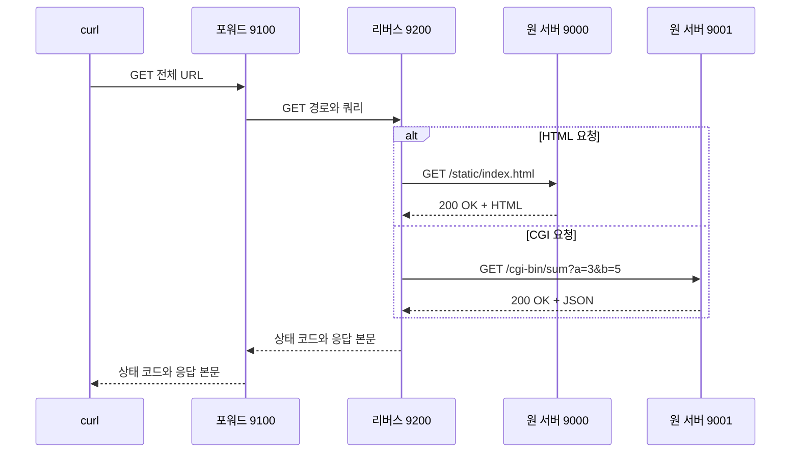
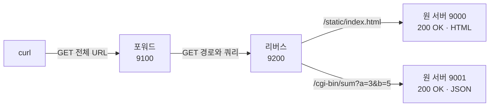

# Jungle-LLM-webServer

## 요구사항

### 과제 개요

표준 C 라이브러리와 POSIX 소켓 API로 HTTP 서버를 구현합니다. macOS의 `kqueue`로 소켓을 감시하고, 정적 파일 서빙과 프록시를 같은 서버에 구성합니다. [LMS 과제](https://jungle-lms.krafton.com/learning/1309)

### 필수 구현 항목

#### TCP 소켓 서버

서버는 `socket() → bind() → listen() → accept()` 순서로 연결을 받고, `recv()`와 `send()`로 요청과 응답을 주고받습니다. [서버 소켓 설정](src/tcp_server.c#L770) · [연결 수락](src/tcp_server.c#L413)

#### HTTP 요청 파싱

서버는 `\r\n\r\n`까지 모아 요청 라인과 헤더를 파싱합니다. `Content-Length`가 있으면 해당 바이트 수만큼 본문을 받은 뒤 응답합니다. 헤더는 최대 8 KiB, 본문은 최대 64 KiB까지 받습니다.

메서드·URI·버전과 `Host`, `Content-Length`, `Connection` 등의 헤더를 파싱합니다. 지원 메서드는 `GET`과 `POST`입니다. [요청 파서](src/http.c#L200)

#### HTTP 응답 생성

기본 `GET /`에는 `200 OK`와 본문 `hello`를 보내고, 정상 `POST`의 최종 응답은 `200 OK`와 길이 0인 본문입니다.

HTTP 응답은 상태 라인, 헤더, 본문 순서로 전송합니다. 최종 응답에는 연결을 재사용할지에 따라 `Connection: keep-alive` 또는 `Connection: close`를 붙이고, 응답 종류에 따라 `Content-Type`과 `Content-Length`를 설정합니다. [HTTP 응답 생성](src/http.c#L315)

##### 중간 응답과 3xx 응답

| 상태 | 요청과 처리 |
| --- | --- |
| `100 Continue` | HTTP/1.1 POST에 `Expect: 100-continue` 헤더가 있고 본문이 아직 다 오지 않았다면 중간 응답을 보냅니다. 서버는 같은 연결에서 본문을 이어서 읽고 최종 응답을 보냅니다. |
| `301 Moved Permanently` | `GET /redirect/permanent`에 `Location: /`를 보냅니다. |
| `302 Found` | `GET /redirect`에 `Location: /`를 보냅니다. |
| `303 See Other` | `POST /redirect/after-post`의 본문을 받은 뒤 `Location: /`를 보냅니다. 리다이렉션을 따르면 `/`를 GET으로 요청합니다. |
| `304 Not Modified` | `GET /`에 저장해 둔 `ETag`를 `If-None-Match: "hello-v1"`로 보내면 서버는 `ETag`와 함께 본문 없이 응답합니다. |

#### 정적 파일 서빙

`./build/tcp_server ./public`으로 실행하면 `GET /static/index.html`이 `./public/index.html`을 반환합니다. 루트 인자를 생략하거나 파일이 없으면 `/static/` 아래의 해당 요청은 `404`를 받습니다. 루트 아래의 일반 파일만 제공하며 `..`과 심볼릭 링크는 `403`으로 차단합니다. [파일 열기](src/file_pool.c#L157)

확장자로 `Content-Type`을 정하고 파일 크기를 `Content-Length`로 보냅니다. 헤더를 모두 보낸 뒤 `EVFILT_WRITE`에서 본문을 최대 4 KiB씩 전송합니다. 일부만 전송되면 다음 쓰기 이벤트에서 이어 보냅니다. [파일 본문 전송](src/tcp_server.c#L327)

##### 정적 콘텐츠 오프로딩

**정적 콘텐츠 오프로딩(static content offloading)**은 이미지·CSS·JS 같은 파일을 앞단의 C 서버에서 직접 제공해 백엔드의 부담을 줄이는 방식입니다. C 서버는 미리 배포한 파일을 첫 요청부터 읽어 보낼 수 있습니다. [Microsoft의 리버스 프록시 설명](https://learn.microsoft.com/en-us/aspnet/core/host-and-deploy/linux-nginx?view=aspnetcore-10.0)

포워드 프록시를 `./build/tcp_server_forward -o 9200 ./public`으로 실행하면, 리버스 프록시 `:9200`를 목적지로 하는 GET 요청을 아래와 같이 처리합니다. 파일 워커가 로컬 파일을 읽고, `kqueue` 이벤트 루프가 응답을 전송합니다. [오프로딩 요청 분기](src/tcp_server_forward.c#L420)

| 요청 경로 | 응답을 만드는 서버 |
| --- | --- |
| `/static/index.html` | 리버스 프록시가 C 원 서버 `:9000`으로 전달 |
| `/static/logo.png` | 포워드 프록시 `:9100`이 `./public/logo.png`를 읽음 |
| `/static/style.css` | 포워드 프록시 `:9100`이 `./public/style.css`를 읽음 |

브라우저는 원 서버에서 받은 HTML을 읽은 뒤 로고와 CSS를 별도로 요청합니다. 두 파일은 첫 요청부터 포워드 프록시가 직접 보냅니다. 오프로딩이 켜져 있는 동안 `index.html` 요청은 포워드 캐시를 건너뛰고 원 서버로 중계됩니다.

#### 동적 요청 처리

##### CGI 덧셈 프로그램

프로젝트 폴더에서 `make`를 실행하면 서버와 함께 `cgi_sum`이 빌드됩니다. `./build/tcp_server`를 실행한 뒤 다른 터미널에서 요청을 보냅니다.

```sh
curl -i 'http://127.0.0.1:9000/cgi-bin/sum?a=3&b=5'
```

- `GET /cgi-bin/sum` 요청이 오면 서버는 `fork()`와 `execve()`로 서버 실행 파일과 같은 폴더의 `cgi_sum`을 실행하고, `QUERY_STRING`으로 `a=3&b=5`를 전달합니다. 프로그램은 두 정수를 더해 `{"sum":8}`을 표준 출력으로 보냅니다. [CGI 실행](src/cgi.c#L29) · [덧셈 프로그램](src/cgi_sum.c#L44)
- 서버는 출력 파이프를 `kqueue`의 `EVFILT_READ`로 감시합니다. 읽을 데이터가 생기면 파이프에서 받고, 자식 종료 상태를 회수한 뒤 응답을 보냅니다. 입력이 잘못되면 `400`, 실행이나 출력 처리에 실패하면 `500`, 실행이 5초를 넘기면 `504`를 반환합니다. [출력 처리](src/tcp_server.c#L581) · [이벤트 분기](src/tcp_server.c#L686)

##### 리버스 프록시를 통한 동적 요청

리버스 프록시는 `/cgi-bin/sum?a=3&b=5`의 경로와 쿼리를 기본 원 서버 `:9001`에 그대로 보냅니다. 헬스 체크에서 `9001`의 장애가 확인되면 새 CGI 요청은 정상인 `9000`으로 보냅니다. 원 서버가 CGI 프로그램을 실행해 JSON을 생성하면 리버스 프록시가 응답을 중계합니다.

#### 동시 요청 처리

##### `run_server()`의 `kqueue` 이벤트 루프

현재 서버는 macOS에서 `kqueue`로 프로세스당 최대 10,000개 클라이언트 연결을 관리하도록 설정되어 있습니다. 커널이 소켓의 준비 상태를 알려주면 서버가 `accept()`, `recv()`, `send()`를 호출합니다. 이런 이벤트 기반 구조를 **리액터(Reactor) 패턴**이라고 합니다. [서버 이벤트 루프](src/tcp_server.c#L655)

1. **서버 소켓을 등록합니다.** `kqueue()`로 큐를 만들고, `watch_read(queue, server_fd, NULL)`로 새 접속을 감시합니다. `watch_read()` 안의 `kevent()`가 읽기 감시(`EVFILT_READ`)를 커널에 등록합니다. [감시 등록 코드](src/tcp_server.c#L448)
2. **이벤트를 기다립니다.** 바깥 `for (;;)`에서 `kevent()`를 호출합니다. 준비된 이벤트가 없으면 기다리고, 이벤트가 생기면 결과 배열 `events`에 담아 반환합니다. 안쪽 `for`는 이번에 반환된 이벤트 개수인 `count`만큼 순회합니다. [이벤트 대기 코드](src/tcp_server.c#L677)
3. **이벤트에 따라 처리합니다.** `filter`로 시그널과 타이머를 먼저 구분합니다. 읽기·쓰기 이벤트는 `ident`의 파일 디스크립터로 서버 소켓, 파일 완료 알림 파이프, CGI 출력 파이프, 클라이언트 소켓을 구분합니다. 클라이언트 이벤트에서는 `udata`의 주소로 연결 상태를 찾습니다. [이벤트 분기 코드](src/tcp_server.c#L686)
4. **기존 이벤트를 처리한 뒤 새 접속을 받습니다.** `listener`에 새 접속 이벤트가 있으면 최대 64개를 수락합니다. `accept_client()`가 새 연결을 빈자리에 저장하고 `watch_read()`가 그 소켓의 읽기 감시를 등록합니다. 대기 중인 연결이 없거나 한 번에 받을 한도에 도달하면 `kevent()`로 돌아갑니다. [새 접속 처리 코드](src/tcp_server.c#L770)

###### `kevent()`에서 감시 등록과 이벤트 대기

```c
// watch_read()에서 읽기 감시 등록
kevent(queue, &change, 1, NULL, 0, NULL);

// run_server()의 반복문에서 이벤트 받기
kevent(queue, NULL, 0, events, MAX_EVENTS, NULL);
```

- **감시 등록**은 `&change, 1`로 읽기 감시(`EVFILT_READ`)를 하나 등록합니다. 결과 배열과 최대 수신 개수가 `NULL, 0`이라 등록에 성공하면 바로 `0`을 반환합니다. [감시 등록 코드](src/tcp_server.c#L448)
- **이벤트 대기**는 결과 배열 `events`에 준비된 이벤트를 받습니다. 준비된 이벤트가 없으면 마지막 인자가 `NULL`이므로 시간 제한 없이 기다립니다. 예를 들어 새 연결을 받을 수 있게 되면 `server_fd`의 읽기 이벤트가 `events`에 들어갑니다. [이벤트 대기 코드](src/tcp_server.c#L677)

이벤트 루프 스레드 하나가 대기와 감시 등록을 순서대로 수행합니다. 새 접속이 오면 커널이 이미 감시 중인 `server_fd`의 읽기 이벤트를 전달해 대기 중인 `kevent()`가 반환합니다. 그 뒤 서버가 `accept()`로 새 연결을 받고, `watch_read()`로 새 소켓의 읽기 감시를 등록합니다. [새 접속 처리 코드](src/tcp_server.c#L735)

##### `kqueue`와 파일 스레드풀

```text
이벤트 루프  → GET 요청을 다 받음 → 파일 읽기 작업을 큐에 넣음
워커        → 파일을 열고 읽음  → 완료 큐에 결과를 넣고 이벤트 루프를 깨움
이벤트 루프  → 결과를 꺼냄      → EVFILT_WRITE에서 헤더와 파일 데이터를 전송
```

정적 파일 루트를 지정하면 서버는 `pthread` 워커 4개를 시작합니다. 첫 작업에서 파일을 열어 크기를 확인하고 최대 4 KiB를 읽습니다. 워커는 완료 큐에 결과를 넣은 뒤 파이프에 한 바이트를 씁니다. 이벤트 루프는 파이프의 `EVFILT_READ`를 받아 결과를 꺼내고, 클라이언트 소켓의 쓰기 감시를 등록합니다. [파일 워커](src/file_pool.c#L248) · [완료 처리](src/tcp_server.c#L524)

현재 버퍼를 다 보냈고 파일에 남은 바이트가 있으면 같은 작업을 다시 큐에 넣습니다. 다음 데이터가 준비될 때까지 해당 소켓의 쓰기 감시는 잠시 멈춥니다. 연결 상태는 이벤트 루프가 관리하며, 결과를 적용하기 전에 배열 자리와 연결 ID가 일치하는지 확인합니다. 전송 중인 파일을 포함해 최대 10,000개의 파일 작업을 유지하고, 한도에 도달하면 새 파일 요청에 `503 Service Unavailable`을 반환합니다. [파일 송신](src/tcp_server.c#L327) · [작업 등록](src/file_pool.c#L368)

### Proxy 또는 Reverse Proxy 구현

이 프로젝트는 HTTP 포워드 프록시와 두 C 원 서버에 요청을 분산하는 리버스 프록시를 구현합니다.

#### 포워드 프록시

- **역할과 용도** · 클라이언트 대신 요청 URL의 원 서버에 접속하고 응답을 돌려줍니다. 회사에서는 이 지점에서 직원들의 외부 사이트 접속을 허용하거나 차단할 수 있습니다.

##### 로컬 HTTP 중계

이 포워드 프록시는 **HTTP 전용**입니다. 기본 목적지는 `http://127.0.0.1:9000`이며, `-o 9200`을 주면 `GET`과 `POST`를 로컬 리버스 프록시로 중계합니다. HTTPS 터널링(`CONNECT`)은 구현 범위에서 제외합니다.

- **GET·POST 중계** · 프록시는 전체 URL에서 경로와 쿼리를 꺼내 목적지에 보냅니다. POST는 `Content-Length`와 본문을 전달하고, `Content-Type`도 요청에 있으면 함께 보냅니다. 송수신은 `kqueue`가 처리합니다. 정적 파일 오프로딩과 캐싱은 GET에 적용합니다. [중계 요청 생성](src/tcp_server_forward.c#L351)
- **원 서버 연결 재사용** · `Content-Length`만큼 본문을 다 전달한 뒤 두 연결이 모두 유지되면, 같은 클라이언트의 다음 중계 요청에 기존 원 서버 소켓을 씁니다. 원 서버가 연결을 닫으면 다음 중계 요청에서 새로 연결합니다. [응답 완료와 소켓 재사용](src/tcp_server_forward.c#L613)

`204`와 `304`는 헤더에서 응답이 끝납니다. 연결 종료로 본문 길이를 표시하는 응답은 EOF까지 중계합니다. `Transfer-Encoding: chunked`는 현재 지원 범위에서 제외됩니다.

아래 순서로 빌드한 뒤, 원 서버와 포워드 프록시를 각각 다른 터미널에서 실행합니다. `curl`은 세 번째 터미널에서 실행합니다.

```sh
make tcp_server tcp_server_forward
./build/tcp_server ./public
./build/tcp_server_forward
curl -v --noproxy '' -x http://127.0.0.1:9100 \
  http://127.0.0.1:9000/static/index.html \
  http://127.0.0.1:9000/static/logo.png -o /dev/null -o /dev/null
```

##### 캐시 정책

원 서버는 `/static/` 파일을 성공적으로 보낼 때 **원 서버 → 포워드 프록시** 구간의 응답에 `Cache-Control: public, max-age=60`을 붙입니다. `public`은 프록시처럼 여러 클라이언트가 쓰는 캐시에 저장해도 된다는 뜻이고, `max-age=60`은 응답을 60초 동안 유효한 것으로 취급할 수 있다는 뜻입니다. 이 헤더를 받으면 프록시는 응답을 저장 후보로 검토합니다. [원 서버의 정적 파일 응답](src/tcp_server.c#L518)

**저장 조건**

- 프록시가 중계하는 HTTP/1.1 `GET`에 캐시를 적용합니다. 저장 키는 경로와 쿼리를 포함한 전체 URL입니다. 예를 들어 `/static/logo.png?v=1`과 `/static/logo.png?v=2`는 별도 항목입니다.
- 요청에 `Authorization`, `Cookie`, `Range`, `If-*`, `Cache-Control`, `Pragma` 헤더가 있으면 캐시 조회와 저장을 건너뜁니다. 원 서버 응답에 `Vary`, `Set-Cookie`, `Content-Range`, `Age`가 있어도 저장을 건너뜁니다.
- 원 서버가 `public`과 양의 정수 `max-age`를 명시한 `200 OK` 응답만 저장합니다. `private`, `no-store`, `no-cache` 같은 지시어가 붙으면 저장을 건너뜁니다. `Content-Length`가 있어야 하고 본문은 최대 2 MiB입니다. 프록시는 받은 본문을 클라이언트에 보내면서 메모리에 복사하고, **선언된 바이트를 모두 받은 뒤에** 헤더와 본문을 캐시에 등록합니다. [저장 조건 확인](src/proxy_response.c#L166) · [본문 저장과 등록](src/proxy_cache.c#L199)

**요청 순서와 만료**

| 같은 URL에 대한 요청 | 프록시 동작 |
| --- | --- |
| 첫 번째 | 캐시가 비어 있으면 원 서버에서 응답을 받아 전달하고 요청 시각을 기록합니다. |
| 두 번째 | 첫 요청 후 30초 이내라면, 원 서버에서 받은 응답이 저장 조건을 충족할 때 캐시에 등록합니다. |
| 세 번째 이후 | 유효한 응답이 있으면 원 서버에 요청을 보내지 않고 메모리에서 바로 응답합니다. 다른 클라이언트도 같은 캐시를 사용할 수 있습니다. |
| 만료 후 | 조회 시 만료된 항목을 제거하고 원 서버에 다시 요청합니다. 저장 후보는 다시 최근 요청 기록을 기준으로 판정합니다. |

**30초는 저장 후보를 고르는 기준**이고, **60초는 원 서버 응답의 유효 기간**입니다. 응답이 도착할 때까지 이미 지난 시간도 유효 기간에 포함합니다. 캐시로 응답할 때 프록시는 `Age`에 계산한 응답의 나이를 초 단위로 넣습니다. 예를 들어 `max-age=60`인 응답의 `Age`가 `12`라면 남은 유효 기간은 약 48초입니다. [요청 기록과 캐시 조회](src/proxy_cache.c#L74)

캐시는 최대 16개 응답을 보관합니다. 저장 중인 응답과 이미 저장된 응답을 포함한 메모리 한도는 8 MiB입니다. 공간이 부족하면 만료 항목부터 제거하고, 추가 공간이 필요하면 최근 사용 시점이 가장 오래된 항목부터 제거합니다(LRU). 새 응답을 받을 공간을 확보할 수 없으면 그 응답은 클라이언트에 전달만 합니다. [메모리 한도와 제거](src/proxy_cache.c#L134)

앞의 로컬 HTTP 중계 예제처럼 포워드 프록시를 `./build/tcp_server_forward`로 새로 실행한 상태에서 같은 URL을 세 번 요청하면, 세 번째 응답의 `Age` 헤더로 캐시 사용 여부를 확인할 수 있습니다.

```sh
url='http://127.0.0.1:9000/static/index.html'
for i in 1 2 3; do
  curl -sS -D - -o /dev/null --noproxy '' -x http://127.0.0.1:9100 "$url"
done
```

#### 리버스 프록시와 Round-Robin


`src/tcp_server.c`로 빌드한 같은 서버를 두 포트에서 실행합니다. 리버스 프록시는 URL의 경로로 백엔드 그룹을 고른 뒤, 그 그룹에서 원 서버 한 대를 선택합니다. 쿼리는 경로 비교에서 제외하며 원 서버에 그대로 전달합니다. [경로와 백엔드 선택](src/tcp_server_reverse.c#L228)

| 기본 경로 | 원 서버 선택 |
| --- | --- |
| `/static/index.html` | `9000` |
| `/cgi-bin/sum` | `9001` 우선. 헬스 체크에서 장애가 확인되면 정상인 `9000`에 전달 |
| 그 외 리버스 프록시에 들어온 경로 | `9000 → 9001 → 9000` 순서로 Round-Robin |

`-r '/경로=포트[,포트...]'`로 정확히 일치하는 경로의 그룹을 지정하거나 기본 규칙을 덮어쓸 수 있습니다. 포트는 기본 백엔드 목록이나 `-b`로 등록한 목록에 있어야 합니다. 한 경로에 서버가 두 대 이상이면 그 경로의 요청끼리 번갈아 분산됩니다. 예를 들어 `./build/tcp_server_reverse -H 5 -r '/cgi-bin/sum=9000,9001'`은 CGI 요청에도 Round-Robin을 적용합니다. [라우팅 옵션 파싱](src/tcp_server_reverse.c#L1055)

리버스 프록시는 한 `kqueue`에서 양쪽 소켓을 감시하고, 부분 송수신 위치를 유지하면서 HTTP 응답을 중계합니다. `GET`과 `POST`는 포워드 프록시를 거쳐도 원 서버까지 전달됩니다. [원 서버 이벤트 처리](src/tcp_server_reverse.c#L826)

##### HTML과 CGI 요청·응답 흐름



##### 경로별로 서버를 나누는 이유

`9000`은 HTML 파일을 읽고 `9001`은 CGI 자식 프로세스를 실행합니다. 각 프로세스에 별도의 연결 슬롯이 있어 CGI 요청이 몰릴 때도 `9000`은 HTML 요청을 받을 수 있습니다. 같은 Mac에서 실행하는 동안 CPU·디스크·네트워크는 공유합니다.

트래픽이 늘어난 경로의 서버 그룹만 확장하고, 그 그룹 안에서 Round-Robin으로 분산할 수 있습니다. 두 원 서버에 같은 C 프로그램을 배포했기 때문에 `9000`은 평소 HTML을 처리하다가 `9001`의 장애가 확인되면 새 CGI 요청도 맡을 수 있습니다.

##### 원 서버 연결 확인과 헬스 체크

리버스 프록시 실행 시 `-H`에 헬스 체크 주기를 초 단위로 지정합니다. 예를 들어 다음 명령은 `9000`과 `9001`을 시작 직후 확인하고, 이후 5초마다 다시 확인합니다.

```sh
make tcp_server tcp_server_reverse
./build/tcp_server_reverse -p 9200 -b 9000 -b 9001 -H 5
```

- **헬스 체크** · 실제 요청과 별개로 원 서버의 `GET /health`를 논블로킹으로 호출합니다. 1초 안에 `200 OK` 응답 헤더를 받은 서버를 정상으로 표시합니다. `9001`의 복구를 확인하면 새 CGI 요청을 다시 `9001`로 보냅니다. 해당 경로에서 사용할 수 있는 정상 서버가 하나도 없으면 `503 Service Unavailable`을 보냅니다. [원 서버의 헬스 엔드포인트](src/tcp_server.c#L175) · [헬스 체크 시작](src/tcp_server_reverse.c#L648)
- **실제 요청의 연결 확인** · 프록시는 선택된 원 서버에 논블로킹 `connect()`를 호출한 뒤, 연결이 진행 중이면 `EVFILT_WRITE`에서 `SO_ERROR`를 확인합니다. 점검 사이에 원 서버가 내려가면 실제 TCP 연결 실패를 `502`로 처리합니다. 응답을 보내기 전에 원 서버와 송수신이 5초간 진행되지 않으면 `504`를 반환합니다. [TCP 연결 확인](src/tcp_server_reverse.c#L745)
- **기본 실행** · `-H`를 생략하면 각 경로에 지정된 그룹의 원 서버를 모두 선택 대상으로 삼습니다.

빌드한 뒤 네 프로세스를 각각 다른 터미널에서 실행합니다.

```sh
make tcp_server tcp_server_forward tcp_server_reverse
./build/tcp_server -p 9000 ./public
./build/tcp_server -p 9001 ./public
./build/tcp_server_reverse -H 5
./build/tcp_server_forward -o 9200 ./public
```

두 원 서버의 첫 헬스 체크가 끝난 뒤, 다른 터미널에서 아래 요청의 `X-Backend-Port`를 확인합니다. HTML은 `9000`, CGI는 `9001`을 사용하고 `/`는 기본 그룹에서 `9000`, `9001`, `9000` 순서로 분산됩니다.

```sh
for path in /static/index.html '/cgi-bin/sum?a=3&b=5' / / /; do
  curl -sS -D - -o /dev/null --noproxy '' -x http://127.0.0.1:9100 \
    "http://127.0.0.1:9200$path" | grep -i '^X-Backend-Port:'
done
```

백엔드 포트 목록은 리버스 프록시에 `-b`를 반복해 지정할 수 있습니다. `-b 9000 -b 9001`은 기본 목록과 같은 순서입니다.

##### 데모 1번 · HTML과 CGI 요청



응답은 **원 서버 → 리버스 → 포워드 → curl** 순서로 돌아옵니다. 터미널에서 HTML은 `X-Backend-Port: 9000`, CGI는 `X-Backend-Port: 9001`과 본문 `{"sum":8}`을 확인합니다.

##### 원 서버 직접 요청 제한

원 서버와 리버스 프록시에 같은 `JUNGLE_ORIGIN_TOKEN`을 설정하면, 원 서버는 토큰이 없는 직접 HTTP 요청을 `403 Forbidden`으로 거절합니다. 리버스 프록시는 클라이언트가 보낸 내부 토큰 헤더를 제거하고, 자신에게 설정된 토큰을 실제 중계 요청과 헬스 체크에 붙입니다.

`9001`을 보호하려면 프로젝트 루트에서 다음과 같이 실행합니다. `9000`과 포워드 프록시는 앞에 나온 실행 명령을 사용합니다.

```sh
make tcp_server tcp_server_reverse
(
  JUNGLE_ORIGIN_TOKEN="$(openssl rand -hex 32)" || exit 1
  export JUNGLE_ORIGIN_TOKEN
  ./build/tcp_server -p 9001 ./public &
  origin_9001_pid=$!
  trap 'kill "$origin_9001_pid" 2>/dev/null || true' EXIT
  ./build/tcp_server_reverse -H 5
)
```

첫 헬스 체크가 끝난 뒤 다른 터미널에서 같은 CGI 요청을 두 경로로 보냅니다.

```sh
# 원 서버에 직접 요청 · 403 Forbidden
curl --noproxy '*' -i 'http://127.0.0.1:9001/cgi-bin/sum?a=3&b=5'

# 포워드와 리버스를 거쳐 요청 · 200 OK, {"sum":8}
curl --noproxy '' -i -x http://127.0.0.1:9100 \
  'http://127.0.0.1:9200/cgi-bin/sum?a=3&b=5'
```

`9000`도 보호하려면 같은 토큰을 설정해 실행합니다. 토큰 검사는 원 서버가 HTTP 헤더를 읽는 단계에서 적용합니다. 같은 Mac의 클라이언트는 리버스 프록시 `9200`에 직접 요청할 수 있습니다.

### 프로젝트 구조

| 폴더 | 내용 |
| --- | --- |
| `src/` | C 서버·클라이언트·프록시와 공통 모듈 소스 |
| `include/` | 공통 헤더 |
| `public/` | 서버와 포워드 프록시가 제공하는 HTML·CSS·이미지 |
| `docs/` | 요청 경로 그림과 시각화 자료 |
| `build/` | `make`가 생성하는 실행 파일 |

### 기술 스택과 제한

서버는 C로 작성하고 표준 C 라이브러리, POSIX 소켓 API, `pthread`, macOS의 `kqueue`를 사용합니다. HTTP 파싱과 이벤트 루프는 직접 구현합니다. 빌드는 [Makefile](Makefile)을 사용합니다.

#### 실행 방법

프로젝트 루트에서 `make`로 빌드한 뒤 `./build/tcp_server`를 실행합니다. 다른 터미널에서 `./build/tcp_client GET /` 또는 `./build/tcp_client POST /submit 'hello'`로 요청을 보낼 수 있습니다.

정적 파일을 제공하려면 `./build/tcp_server ./public`처럼 루트 디렉토리를 인자로 넘깁니다. 기본 주소는 `127.0.0.1:9000`이고, `-p`로 수신 포트를 지정할 수 있습니다.

프록시 작업용 서버는 `make tcp_server_forward tcp_server_reverse`로 빌드합니다. 기본 수신 포트는 포워드 `9100`, 리버스 `9200`이고, `-p`에 `1`부터 `65535`까지의 포트를 지정할 수 있습니다.

```sh
./build/tcp_server_forward -p 9100 -o 9200 ./public
./build/tcp_server_reverse -p 9200 -b 9000 -b 9001
```

### 개발 환경

현재 서버의 빌드 대상은 macOS입니다. 다른 운영체제로 이식할 때는 이벤트 감시 API의 플랫폼 차이를 처리해야 합니다.

## 중점 포인트

### 소켓 프로그래밍

현재 TCP 서버는 `socket()`으로 서버 소켓을 만든 뒤 `SO_REUSEADDR`를 켜고 `bind()`를 호출합니다. 다른 서버가 이미 같은 주소와 포트에서 `listen()` 중이면 `bind()`는 실패합니다. [서버 코드](src/tcp_server.c)

#### 소켓 옵션

소켓 수준(`SOL_SOCKET`)의 옵션은 `setsockopt()`로 설정하거나 `getsockopt()`로 조회합니다.

| 옵션 | 역할 |
| --- | --- |
| `SO_REUSEADDR` | 서버를 재시작할 때 이전 연결이 `TIME_WAIT`에 남아 있어도 같은 주소와 포트에 다시 `bind()`할 수 있게 합니다. |
| `SO_KEEPALIVE` | TCP 연결이 한동안 유휴 상태이면 운영체제가 확인 패킷을 보내 상대가 응답하는지 확인합니다. |
| `SO_RCVTIMEO` | 블로킹 `recv()` 호출이 데이터를 기다리는 시간을 제한합니다. |
| `SO_SNDTIMEO` | 블로킹 `send()` 호출이 데이터를 보낼 수 있을 때까지 기다리는 시간을 제한합니다. |
| `SO_RCVBUF` / `SO_SNDBUF` | 운영체제가 소켓의 수신·송신 데이터를 임시로 보관하는 버퍼 크기를 설정합니다. |
| `SO_ERROR` | 소켓에 기록된 오류를 조회합니다. 논블로킹 `connect()`의 성공 여부를 확인할 때 사용할 수 있습니다. |

#### 블로킹 방식

블로킹 에코 서버는 `accept()`로 접속을 받고, 메시지를 읽어 돌려준 뒤 클라이언트 소켓을 닫고 다음 `accept()`로 돌아갑니다. 접속한 A가 데이터를 보내지 않으면 서버는 A의 `recv()`에서 대기하므로, A와의 처리가 끝나야 B의 접속을 `accept()`할 수 있습니다.

#### 논블로킹 소켓

`fcntl()`로 소켓에 `O_NONBLOCK`을 설정하면, `accept()`나 `recv()`가 지금 할 수 있는 일이 없을 때 `-1`을 반환하고 `errno`를 `EAGAIN` 또는 `EWOULDBLOCK`으로 설정합니다.

여러 소켓의 준비 상태를 기다리고, 준비된 소켓을 처리하는 반복을 **이벤트 루프**라고 합니다.

### HTTP 프로토콜과 연결 유지

**HTTP keep-alive**는 같은 TCP 연결을 열어 두고 여러 HTTP 요청과 응답을 주고받는 동작입니다. 기본 HTTP 요청·응답을 구현할 때는 TCP `SO_KEEPALIVE`를 기본값으로 두어도 됩니다.

- HTTP/1.1에서는 연결을 기본으로 재사용하고 `Connection: close` 요청에는 최종 응답을 보낸 뒤 연결을 닫습니다. HTTP/1.0에서는 `Connection: keep-alive`를 요청했을 때 재사용합니다. [연결 유지 판단](src/tcp_server.c#L258) · [RFC 9112 · 지속 연결](https://www.rfc-editor.org/rfc/rfc9112.html#section-9.3)
- 최종 응답을 모두 보냈으면 요청 정보를 초기화합니다. 같은 `recv()`에서 받은 다음 요청의 바이트가 있으면 이어서 파싱하고, 새 요청을 기다리기 시작한 뒤 5초 동안 데이터가 없으면 연결을 닫습니다. [응답 완료 처리](src/tcp_server.c#L299)

서버를 실행한 상태에서 아래처럼 같은 호스트의 URL 두 개를 한 `curl` 명령으로 요청할 수 있습니다. `-v` 출력에서 연결 재사용 여부를 볼 수 있습니다.

```sh
curl -v 'http://127.0.0.1:9000/' 'http://127.0.0.1:9000/cgi-bin/sum?a=3&b=5'
```

### 동시성 모델과 논블로킹 고려 사항

프로세스, 스레드풀, 이벤트 루프를 선택할 때는 여러 연결에 작업을 나누는 방식과 공유 자원을 안전하게 사용하는 방법을 함께 고려합니다.

논블로킹으로 여러 연결을 처리하면 **서버가 연결마다 어디까지 읽고 보냈는지 기억해야 합니다.** 지금 HTTP 서버에서 특히 중요한 건 아래 네 가지입니다.

1. **요청이 여러 번에 나뉘어 들어옵니다.** 서버는 연결마다 `header_length`와 `body_received`에 받은 바이트 수를 기록합니다. B가 `Content-Length: 5`인 일반 POST 요청을 보낸다면 다음과 같이 처리합니다.

   - **헤더와 `he`가 먼저 도착합니다.** `read_request_bytes()`는 본문 2바이트를 B의 버퍼에 저장합니다. 아직 `2 / 5`바이트이므로 `0`을 반환합니다. [요청 수신 코드](src/tcp_server.c#L113)
   - **읽기 감시를 유지합니다.** `handle_client()`는 반환값이 `0`이면 응답을 준비하지 않습니다. `response_length`가 계속 `0`이므로 `service_kqueue_client()`는 `EVFILT_READ` 등록을 유지합니다. 서버는 다시 `kevent()`로 돌아가 다른 연결의 이벤트도 받을 수 있습니다. [요청 처리](src/tcp_server.c#L349) · [감시 전환 조건](src/tcp_server.c#L491)
   - **`llo`가 도착하면 이어서 읽습니다.** `kevent()`가 B의 읽기 이벤트를 다시 돌려주면, 서버는 `event->udata`로 같은 연결 상태를 찾아 `body_received = 2`부터 저장합니다. 본문이 `5 / 5`바이트가 되면 `200 OK` 응답을 준비하고 감시를 `EVFILT_WRITE`로 바꿉니다. [클라이언트 이벤트 처리](src/tcp_server.c#L478)

2. **응답도 일부만 보낼 수 있습니다.** `send()`가 응답 60바이트 중 20바이트만 보냈다면, 다음 쓰기 이벤트에서 **21번째 바이트부터** 이어 보내야 합니다. 아직 보낼 데이터가 있을 때만 쓰기 이벤트(`EVFILT_WRITE`)를 감시해야 이벤트 루프가 계속 깨어나는 일을 피할 수 있습니다. [응답 송신 코드 (line 370)](src/tcp_server.c#L370)
3. **느리거나 멈춘 연결이 자리를 오래 차지할 수 있습니다.** 한 클라이언트가 헤더를 반만 보내고 멈추면 다른 클라이언트는 계속 처리할 수 있지만, 멈춘 연결은 소켓과 버퍼를 계속 차지합니다. 서버의 연결 슬롯은 **최대 10,000개**입니다. CGI 실행과 응답 직후의 유휴 대기는 각각 5초로 제한합니다. 요청 수신이 시작된 뒤에는 별도의 시간 제한을 적용하는 방안을 고려할 수 있습니다. [이벤트 루프](src/tcp_server.c#L655)
4. **이벤트 루프 안의 느린 작업은 다른 연결도 지연시킵니다.** 나중에 프록시를 붙여 A의 요청을 처리하면서 백엔드 응답을 블로킹으로 기다리면, 같은 스레드가 B의 요청도 처리하지 못합니다. 백엔드 소켓도 이벤트 루프에 등록하거나, 오래 걸리는 작업을 워커 스레드에 맡기는 방식으로 처리할 수 있습니다.

   현재 정적 파일의 `read()`는 워커가 수행하므로, 파일 I/O를 기다리는 동안 이벤트 루프는 다른 연결을 처리할 수 있습니다. [파일 읽기 코드](src/file_pool.c#L224)

#### C10K 설계 고려사항

C10K는 클라이언트 연결 1만 개를 동시에 처리하는 문제입니다. 저희 서버는 `kqueue`로 여러 연결을 감시하고, 읽거나 쓸 준비가 된 소켓을 이벤트 루프에서 처리합니다. 디스크에서 파일을 읽는 작업은 워커 4개에 맡겨서, 파일을 기다리는 동안에도 다른 클라이언트의 요청을 처리할 수 있습니다.

연결 슬롯은 프로세스당 10,000개이며, 시작 시 `calloc()`으로 힙에 할당하고 종료할 때 해제합니다. 서버 시작 스크립트는 실행할 프로세스의 파일 디스크립터 한도를 32,768개로 설정합니다. [연결 슬롯 할당](src/tcp_server.c#L699) · [서버 시작 스크립트](scripts/start-servers.sh#L10)

로컬 테스트에서는 각 원 서버, 리버스 경유, 포워드 → 리버스 경유에서 각각 TCP 연결 1,000개를 먼저 열고 `GET /`를 순서대로 보냈습니다. 네 경로 모두 `200 OK`와 `hello`가 1,000건씩 확인됐습니다. [동시 연결 테스트](tests/test_connection_capacity.py)

`--connections 1000 --concurrent-rounds 10`은 포워드 프록시에 연결 1,000개를 순서대로 열고, 각 연결을 재사용해 `GET /`를 한 번에 1,000개씩 보냅니다. 로컬에서 3회 실행했고, 매번 전체 프록시 경로에서 10,000건 모두 `200 OK`와 `hello`가 확인됐습니다. 이 Mac의 `kern.ipc.somaxconn`은 128이며, `ab -c 1000`으로 새 연결을 한꺼번에 열 때는 `Connection reset by peer`가 재현됐습니다. [동시 요청 테스트](tests/test_connection_capacity.py)

C10K 테스트는 `--connections 10000 --hold-seconds 30`으로 실행합니다. 연결을 최대 32개씩 열고, 10,000개가 준비되면 30초 동안 같은 소켓으로 주기적으로 `GET /`를 보냅니다. 유지 시간이 지난 뒤 모든 연결에서 `200 OK`와 `hello`를 다시 확인합니다. `--origin-only`를 추가하면 `9000` 원 서버를 직접 테스트합니다. [C10K 테스트](tests/test_connection_capacity.py)

### 포워드 프록시와 리버스 프록시의 역할

포워드 프록시는 클라이언트를 대신해 목적지로 요청을 보내며 외부 접속 정책과 캐싱을 적용할 수 있습니다. 리버스 프록시는 백엔드의 입구에서 요청을 라우팅하고 여러 백엔드에 부하를 나눌 수 있습니다.

#### 보안 정책

- **포워드 프록시**는 설정된 `127.0.0.1` 주소와 포트로만 요청을 중계합니다. `Authorization`이나 `Cookie`가 포함된 요청에서는 공유 캐시의 조회와 저장을 건너뜁니다. [목적지 검사](src/tcp_server_forward.c#L402) · [캐시 정책](#캐시-정책)
- **리버스 프록시**는 클라이언트가 보낸 내부 토큰 헤더를 제거합니다. 리버스에 `JUNGLE_ORIGIN_TOKEN`을 설정하면 중계 요청과 헬스 체크에 설정된 토큰을 붙입니다. 같은 토큰을 설정한 원 서버는 유효한 토큰이 없는 HTTP 요청을 `403`으로 거절합니다. [설정과 시연 명령](#원-서버-직접-요청-제한)

### 메모리와 파일 디스크립터 관리

- **연결이 끝나면 파일과 소켓을 닫습니다.** 클라이언트가 `logo.png`를 받다가 끊으면 `close_client()`에서 클라이언트 소켓과 전송 중인 파일을 닫고, 요청 본문 메모리를 해제합니다. 그 연결에 대해 진행 중이던 파일 작업은 완료 결과를 꺼낼 때 정리합니다. `close()`를 빠뜨려 파일 디스크립터 한도에 도달하면 새 연결을 받거나 파일을 열지 못할 수 있습니다. [연결 정리 코드](src/tcp_server.c#L402)
- **요청 값을 검증합니다.** `Content-Length`를 확인한 뒤 본문을 받고, 헤더는 최대 8 KiB, 본문은 최대 64 KiB로 제한합니다. 정적 파일 URI에서 `..`이나 심볼릭 링크를 통한 접근을 막습니다. [HTTP 크기 제한](include/http.h#L8) · [파일 경로 검사](src/file_pool.c#L157)

### 시그널과 종료 처리

원 서버와 포워드·리버스 프록시 세 곳 모두 아래 종료 처리를 구현합니다.

| 항목 | 현재 동작 |
| --- | --- |
| **클라이언트 연결 끊김** | `recv()`로 연결 종료를 확인하거나 복구할 수 없는 송수신 오류가 발생하면 `close_client()`로 소켓과 요청 버퍼를 정리합니다. 프록시는 중계 중인 서버 소켓도 닫고, `fd`를 `-1`로 바꿔 슬롯을 다시 쓸 수 있게 합니다. [원 서버](src/tcp_server.c#L429) · [포워드](src/tcp_server_forward.c#L720) · [리버스](src/tcp_server_reverse.c#L536) |
| **`SIGINT` / `SIGTERM`** | `Ctrl+C`나 종료 신호를 `kqueue`에서 받으면 새 연결 수락을 중단하고 열린 연결을 닫습니다. 원 서버는 CGI 자식 프로세스와 파일 워커도 정리합니다. 현재는 진행 중인 요청의 연결도 닫고 종료하는 방식입니다. [종료 처리](src/tcp_server.c#L774) |
| **`SIGPIPE` 무시** | 쓰기 도중 상대가 끊겨도 프로세스 전체가 종료되는 일을 막습니다. 해당 연결의 실패는 `send()`의 반환값으로 처리합니다. [시그널 설정](src/tcp_server.c#L813) |

### 요청·연결 처리 정책

#### 요청 크기와 형식

| 조건 | 응답 |
| --- | --- |
| 요청 라인과 헤더 영역이 총 8 KiB 초과 | `431 Request Header Fields Too Large` |
| `Content-Length`에 선언된 본문이 64 KiB 초과 | `413 Content Too Large` |
| 요청 형식 오류, HTTP/1.1의 `Host` 누락, 잘못되거나 중복된 `Content-Length` | `400 Bad Request` |
| 지원하지 않는 메서드 | `405 Method Not Allowed` |
| 지원하지 않는 HTTP 버전 | `505 HTTP Version Not Supported` |
| `Transfer-Encoding` 단독 사용 | `501 Not Implemented` |
| 지원하지 않는 `Expect` 값 | `417 Expectation Failed` |

본문의 끝은 `Content-Length`로 판단합니다. `Transfer-Encoding`과 `Content-Length`가 함께 오면 `400`을 반환합니다. [크기 제한](include/http.h#L8) · [요청 파서](src/http.c#L200)

#### 연결 슬롯과 타임아웃

| 정책 | 현재 동작 |
| --- | --- |
| 최대 동시 클라이언트 | 원 서버와 각 프록시의 연결 슬롯은 각각 10,000개입니다. 빈 슬롯이 없으면 새 소켓을 닫습니다. |
| 원 서버·포워드의 keep-alive 유휴 대기 | 응답을 끝낸 뒤 다음 요청 데이터가 5초간 없으면 연결을 닫습니다. |
| 원 서버·포워드의 요청 수신 중 | 데이터가 들어오면 유휴 타이머를 해제합니다. 헤더나 본문을 일부만 보내고 멈춘 연결은 별도의 수신 마감 시간이 없어 클라이언트가 끊을 때까지 슬롯을 차지할 수 있습니다. |
| 리버스의 클라이언트 요청 대기 | 접속 직후부터 5초 유휴 제한을 적용합니다. 요청 데이터를 받으면 타이머를 다시 시작하고, 백엔드 연결 전에 만료되면 클라이언트 연결을 닫습니다. |

연결을 닫을 때 소켓과 요청 본문 버퍼를 정리하고 `fd`를 `-1`로 바꿔 슬롯을 재사용할 수 있게 합니다. [원 서버 연결 정리](src/tcp_server.c#L429) · [포워드 유휴 처리](src/tcp_server_forward.c#L559) · [리버스 타이머 처리](src/tcp_server_reverse.c#L948)

#### 백엔드 장애와 실행 시간 제한

| 조건 | 처리 |
| --- | --- |
| 다음 서버에 연결하지 못하거나 응답 형식이 잘못됨 | 포워드·리버스에서 `502 Bad Gateway` |
| 라우팅 규칙에서 선택할 수 있는 백엔드가 없음 | 리버스에서 `503 Service Unavailable` |
| 프록시가 다음 서버와 요청·응답을 주고받는 중 5초간 진행이 없음 | 응답 전송 시작 전이면 `504 Gateway Timeout`. 응답을 이미 보내기 시작했다면 연결을 닫습니다. |
| 원 서버의 CGI 실행이 5초 안에 끝나지 않음 | CGI를 정리하고 `504 Gateway Timeout` 반환 |

리버스의 주기적 헬스 체크는 `-H`로 켭니다. `-H 5`는 5초마다 점검한다는 뜻이며, 각 점검은 1초 안에 `200 OK` 응답 헤더를 받아야 성공합니다. [헬스 체크와 장애 대응](#원-서버-연결-확인과-헬스-체크)

#### 정적 파일과 원 서버 접근 오류

| 조건 | 응답 |
| --- | --- |
| 파일이 없거나 정적 파일 루트가 지정되지 않음 | `404 Not Found` |
| 파일 권한이 없거나 `..` 또는 심볼릭 링크가 포함된 경로 | `403 Forbidden` |
| 원 서버에 내부 토큰을 설정했고 요청에 올바른 토큰이 없음 | `403 Forbidden` |
| 파일을 읽는 중 내부 오류 발생 | 응답 전송 시작 전이면 `500 Internal Server Error`. 응답을 이미 보내기 시작했다면 연결을 닫습니다. |

[파일 경로 검사와 오류 처리](src/file_pool.c#L110) · [원 서버 직접 요청 제한](#원-서버-직접-요청-제한)

## 품질

과제에서 확인할 항목입니다.

- **단위 테스트** · HTTP 파서, MIME 타입 매핑, 라우팅과 프록시 전달
- **기능 테스트** · `curl`이나 브라우저를 이용한 정적 파일과 프록시 동작, 여러 클라이언트의 동시 접속
- **부하 테스트** · 동시 요청 수에 따른 처리량
- **메모리 검사** · Sanitizer 등을 이용한 메모리 누수와 잘못된 접근 확인
- **예외 상황** · 잘못된 HTTP 요청, 큰 본문과 긴 URI, 백엔드 타임아웃, 클라이언트 연결 종료

### 1. ApacheBench 부하 테스트

`ab → 포워드 → 리버스 → 원 서버` 전체 경로로 `GET /`를 10,000건 보냈습니다.

| 동시성 | Keep-Alive | 완료 / 실패 | 초당 처리량 | 평균 요청 시간 | p95 | 받은 데이터 |
| --- | --- | --- | --- | --- | --- | --- |
| 512 | 끔 | 10,000 / 0 | 14,125건 | 36.2ms | 54ms | 1,280,000바이트 |

### 2. C10K 테스트

| 경로 | 동시 TCP 연결 | 유지 시간 | 검증한 HTTP 응답 | 결과 |
| --- | --- | --- | --- | --- |
| 클라이언트 → 포워드 → 리버스 → 원 서버 | 10,000개 | 30초 | 109,984건 | 통과 |

30초 뒤 처음 열었던 연결 **10,000개 각각에서 `200 OK`와 `hello`**를 확인했습니다.

### 3. ASan·LSan 메모리 검사

| 부하 조건 | 결과 |
| --- | --- |
| `ab` 동시성 512 · Keep-Alive 끔 | 서버 4개 정상 종료. 메모리 접근 오류·누수 보고 없음 |
| 기존 연결 9,488개 유지 + `ab` 동시성 512 | 두 부하 검증 통과. 서버 4개 모두 종료 코드 `0` 확인 |

### 4. 기존 연결 9,488개 유지 + `ab` 동시성 512

ASan·LSan 서버에서 TCP 연결 **9,488개를 30초간 유지**하는 동안, `ab`가 별도 연결로 Keep-Alive 없이 요청 10,000건을 보냈습니다. 설정상 최대 동시 연결은 **9,488 + 512 = 10,000개**입니다.

| 항목 | 결과 |
| --- | --- |
| 기존 연결에서 검증한 누적 응답 | 104,128건 |
| `ab` 완료 / 실패 | 10,000 / 0 |
| `ab` 초당 처리량 | 12,892건 |
| 평균 요청 시간 / p95 / p99 | 39.7ms / 59ms / 71ms |
| `ab`가 받은 데이터 | 1,280,000바이트, 본문 50,000바이트 |

### 부하 테스트와 병목 분석

같은 Mac에서 ApacheBench(`ab`)로 `/static/index.html`에 동시 요청 16개를 보냈습니다. 각 조건은 3회 실행했고, 표에는 초당 처리량의 중앙값을 기록했습니다. 전체 경로에서는 `index.html`이 포워드 캐시를 건너뛰도록 `./public`을 지정했습니다.

#### 요청 경로 비교

원 서버의 파일 워커를 4개로 유지하고 경로마다 한 번에 3,000건씩 요청했습니다.

| 요청 경로 | 초당 처리량 |
| --- | ---: |
| `ab → 원 서버` | 49,781건 |
| `ab → 리버스 → 원 서버` | 22,225건 |
| `ab → 포워드 → 리버스 → 원 서버` | 13,423건 |

#### 파일 워커 수와 연결 재사용 비교

전체 프록시 경로에서 한 번에 1,200건씩 요청하며 조건 하나씩 바꿨습니다.

| 조건 | 초당 처리량 |
| --- | ---: |
| 파일 워커 1개 | 11,621건 |
| 파일 워커 4개 | 15,215건 |
| 파일 워커 8개 | 14,432건 |
| 파일 워커 4개와 연결 재사용(`ab -k`) | 24,612건 |

워커를 4개에서 8개로 늘렸을 때 처리량은 개선되지 않았습니다. 워커를 4개로 유지하며 연결을 재사용했을 때는 약 **62%** 증가했습니다. 별도의 임시 계측 빌드에서 워커 4개의 파일 큐 대기 시간은 평균 약 **6 µs**였습니다. 이번 HTML 요청에서는 프록시 경로의 TCP 연결 처리와 중계 비용이 더 큰 제약으로 보입니다. 리버스는 현재 요청마다 원 서버 연결을 만들고 응답이 끝나면 닫습니다. [백엔드 연결 생성](src/tcp_server_reverse.c#L353) · [응답 후 연결 정리](src/tcp_server_reverse.c#L449)

측정은 로컬의 작은 HTML 파일 하나를 기준으로 합니다. 경로 비교 중 원 서버 직접 접속은 3회 합계 4건, 리버스 경유는 8건의 요청 실패를 기록했습니다. 소켓 연결 오류로 중단된 실행은 표에서 제외했습니다. 앞선 동시 요청 32개 테스트에서 나온 오류 2건의 원인은 이번 비교에서 확인되지 않았습니다.

### 예외 처리 검증

macOS에서 아래 명령으로 **예외 처리 통합 테스트 13건을 실행해 모두 통과했습니다.** 테스트는 임시 디렉터리에 서버를 빌드하고 로컬 임시 포트를 사용합니다.

```sh
python3 tests/test_http_exceptions.py
```

| 엣지 케이스 | 현재 확인한 동작 |
| --- | --- |
| **잘못된 HTTP 요청** | 헤더를 다 보내기 전에 송신을 닫거나 `Host`가 빠지면 `400`을 반환합니다. 지원하지 않는 메서드는 `405`를 반환합니다. `HTTP/1.x`처럼 형식이 잘못된 버전은 `400`, `HTTP/1.2`처럼 지원하지 않는 버전은 `505`를 반환합니다. |
| **큰 본문과 긴 URI** | `/submit`에 본문 **64 KiB**를 보내면 `200`, **64 KiB + 1바이트**를 선언하면 `413`을 반환합니다. 긴 URI나 큰 헤더로 요청 라인과 헤더가 총 **8 KiB**를 초과하면 `431`을 반환합니다. |
| **백엔드 연결 실패** | 헬스 체크를 끈 상태에서 원 서버를 종료하면 리버스가 연결을 시도한 뒤 `502`를 반환합니다. |
| **선택 가능한 백엔드 없음** | 헬스 체크를 켠 상태에서 원 서버가 비정상으로 판정되고 선택 가능한 서버가 없으면 `503`을 반환합니다. |
| **백엔드 무응답과 타임아웃** | 원 서버가 TCP 연결은 받고 HTTP 응답을 보내지 않으면 리버스가 약 5초 뒤 `504`를 반환합니다. |
| **클라이언트가 중간에 끊김** | POST 본문 일부를 보낸 뒤 송신을 닫으면 `400`과 연결 종료를 확인했습니다. TCP `RST`로 강제 종료한 경우에도 원 서버와 두 프록시는 계속 동작했고, 다음 정상 POST는 `200`을 반환했습니다. |

[예외 처리 테스트 코드](tests/test_http_exceptions.py)

## 구현 현황

| 과제 항목 | 현재 상태 |
| --- | --- |
| TCP 소켓 서버 | `socket()` → `bind()` → `listen()` → `accept()` 구현. `127.0.0.1:9000`에서 실행합니다. |
| HTTP 요청 파싱 | `GET`·`POST`, 요청 라인, 주요 헤더, `Content-Length` 기반 본문 처리를 구현했습니다. |
| HTTP 응답 생성 | 상태 라인·헤더·본문 전송과 `100`, `3xx`, `403`·`404`·`500` 등의 응답 처리를 구현했습니다. HTTP `keep-alive`로 한 연결에서 여러 요청을 순서대로 처리합니다. |
| 정적 파일 서빙 | `/static/`에서 파일을 제공하고, 확장자에 따라 MIME 타입을 설정합니다. |
| 동적 요청 처리 | C 원 서버가 `GET /cgi-bin/sum?a=3&b=5`를 받아 CGI 프로그램을 실행하고 JSON을 반환합니다. |
| 동시 요청 처리 | `kqueue`가 연결을 관리하며 연결 슬롯은 프로세스당 10,000개입니다. `pthread` 워커 4개가 정적 파일을 읽습니다. |
| 프록시 | 포워드 프록시는 HTTP GET·POST 중계, 원 서버 연결 재사용, 정적 응답 캐싱을 지원합니다. 리버스 프록시는 경로별 백엔드를 선택하고, 서버가 여러 대인 그룹에서는 Round-Robin으로 요청을 분산합니다. |
