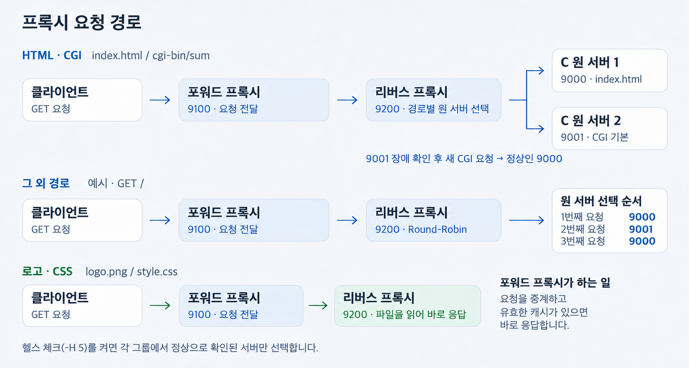
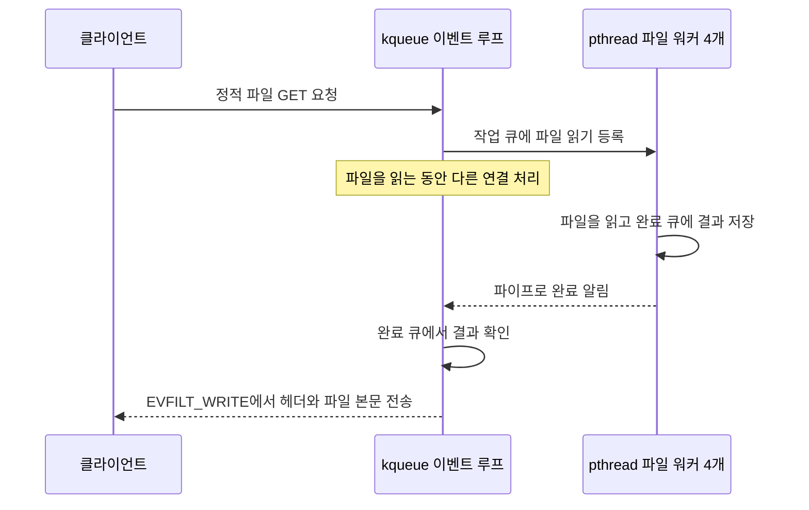

# POSIX C 웹 서버와 HTTP 프록시

POSIX 소켓 API로 HTTP `GET`·`POST`를 처리하는 C 웹 서버를 만들었습니다. macOS에서 포워드 프록시, 리버스 프록시, 원 서버 2대를 실행해 요청 중계와 동시 연결을 검증했습니다.

## 요청 흐름



| 요청 | 처리 경로 |
| --- | --- |
| `/static/index.html` | 리버스를 거쳐 원 서버 `9000`이 HTML 응답 |
| `/cgi-bin/sum?a=3&b=5` | 리버스를 거쳐 원 서버 `9001`이 CGI를 실행하고 `{"sum":8}` 응답 |
| `GET /` | 리버스가 정상 원 서버에 Round-Robin으로 전달 |
| `/static/logo.png`, `/static/style.css` | 포워드가 로컬 파일을 읽어 직접 응답 |

## 동시 연결 처리

- **`kqueue` 이벤트 루프** · 여러 소켓의 읽기·쓰기를 처리합니다. 요청이나 응답이 나뉘어 전송되면 연결별 진행 위치를 기록하고 다음 이벤트에서 이어서 처리합니다.
- **`pthread` 파일 스레드풀** · 워커 4개가 정적 파일을 읽는 동안 이벤트 루프는 다른 연결을 처리합니다.
- 원 서버와 두 프록시의 연결 상태 배열은 힙에 할당합니다. 프로세스마다 연결 슬롯은 10,000개입니다.



## 데모

프로젝트 루트에서 실행합니다. 스크립트가 데모 서버를 빌드해 띄우고, 각 단계는 Enter를 누르면 진행됩니다.

```bash
bash scripts/demo.sh
```

1. **HTML·CGI** · `curl`이 보낸 요청 라인, 중계 경로, HTTP 상태 코드와 응답 본문을 확인합니다.
2. **Round-Robin** · `GET /`를 세 번 보내고 응답의 `X-Backend-Port`가 원 서버 1 → 2 → 1 순서로 바뀌는지 확인합니다.
3. **포워드 캐시** · 같은 HTML을 연속 세 번 요청합니다. 포워드가 첫 요청 시각을 기록하고 두 번째 응답을 캐시에 저장합니다. 세 번째 응답의 `Age` 헤더로 캐시 히트를 확인합니다.

## 검증 결과

부하 테스트는 같은 Mac에서 `클라이언트 → 포워드 → 리버스 → 원 서버` 경로의 `GET /`로 진행했습니다.

| 테스트 | 조건 | 결과 |
| --- | --- | --- |
| ApacheBench | 동시성 512, Keep-Alive 끔, 요청 10,000건 | 실패 0건, 초당 14,125건, 평균 36.2ms, p95 54ms, 수신 1,280,000바이트 |
| C10K | 같은 TCP 연결 10,000개를 30초간 유지 | HTTP 응답 109,984건을 검증했고, 마지막에도 10,000개 소켓 모두 `200 OK`와 `hello` 응답 |
| ASan·LSan | ApacheBench 동시성 512 | 서버 4개가 정상 종료했고 메모리 접근 오류·누수 보고 없음 |
| 복합 부하 | ASan·LSan을 켜고 연결 9,488개를 유지하면서 `ab` 동시성 512로 요청 10,000건 | 기존 연결의 응답 104,128건 검증, `ab` 실패 0건, 초당 12,892건, p95 59ms, 서버 4개 정상 종료 |

C10K에서 같은 Mac의 프록시 여러 구간이 임시 포트를 함께 사용했습니다. 전체 경로 테스트는 임시 포트 범위를 일시적으로 넓혀 통과했고, 종료 후 설정을 복원했습니다.

### 유닛 테스트 및 기능 테스트 검증 완료

유닛 테스트는 임시 C 코드로 실행했고, 기능 테스트는 `curl`과 동시 연결 테스트로 확인했습니다.

| **테스트 항목** | **현재 확인한 동작** |
| --- | --- |
| **유닛 · HTTP 요청 파서** | 정상 `GET`·`POST`의 요청 정보와 `Content-Length`를 읽습니다. HTTP/1.1 요청에 `Host`가 없으면 `400`을 반환합니다. |
| **유닛 · MIME 타입 매핑** | HTML·CSS·PNG·JPEG의 확장자에 맞는 `Content-Type`을 고릅니다. 확장자가 없으면 `application/octet-stream`을 사용합니다. |
| **유닛 · 백엔드 선택** | 경로별 원 서버 선택과 Round-Robin 순서를 확인했습니다. 기본 CGI 서버에 장애가 있으면 정상인 대체 서버를 고릅니다. |
| **기능 · 정적 파일과 CGI** | `curl`로 HTML·CSS·PNG의 상태 코드, `Content-Type`, 본문을 확인했습니다. CGI 덧셈은 `{"sum":8}`을 반환했습니다. |
| **기능 · Round-Robin** | 전체 프록시 경로로 `GET /`를 세 번 보냈을 때 `X-Backend-Port`가 원 서버 1 → 2 → 1 순서로 바뀌었습니다. |
| **기능 · 동시 클라이언트** | 동시 연결 32개에서 요청을 두 번씩 보내 총 64건 모두 `200 OK`와 `hello` 응답을 받았습니다. |

### 예외 처리 검증

macOS에서 아래 명령으로 **예외 처리 통합 테스트 13건을 실행해 모두 통과했습니다.** 테스트는 임시 디렉터리에 서버를 빌드하고 로컬 임시 포트를 사용합니다.

```sh
python3 tests/test_http_exceptions.py
```

| 엣지 케이스 | 현재 확인한 동작 |
| --- | --- |
| **잘못된 HTTP 요청** | 헤더를 다 보내기 전에 송신을 닫거나 `Host`가 빠지면 `400`을 반환합니다. 지원하지 않는 메서드는 `405`를 반환합니다. `HTTP/1.x`처럼 형식이 잘못된 버전은 `400`, `HTTP/1.2`처럼 지원하지 않는 버전은 `505`를 반환합니다. |
| **큰 본문과 긴 URI** | `/submit`에 본문 **64 KiB**를 보내면 `200`, **64 KiB + 1바이트**를 선언하면 `413`을 반환합니다. 긴 URI나 큰 헤더로 요청 라인과 헤더가 총 **8 KiB**를 초과하면 `431`을 반환합니다. |
| **백엔드 연결 실패** | 헬스 체크를 끈 상태에서 원 서버를 종료하면 리버스가 연결을 시도한 뒤 `502`를 반환합니다. |
| **선택 가능한 백엔드 없음** | 헬스 체크를 켠 상태에서 원 서버가 비정상으로 판정되고 선택 가능한 서버가 없으면 `503`을 반환합니다. |
| **백엔드 무응답과 타임아웃** | 원 서버가 TCP 연결은 받고 HTTP 응답을 보내지 않으면 리버스가 약 5초 뒤 `504`를 반환합니다. |
| **클라이언트가 중간에 끊김** | POST 본문 일부를 보낸 뒤 송신을 닫으면 `400`과 연결 종료를 확인했습니다. TCP `RST`로 강제 종료한 경우에도 원 서버와 두 프록시는 계속 동작했고, 다음 정상 POST는 `200`을 반환했습니다. |

[예외 처리 테스트 코드](tests/test_http_exceptions.py)

[상세 구현과 테스트 재현 방법](README2.md) · [HTTP 예외 처리 테스트](tests/test_http_exceptions.py)
